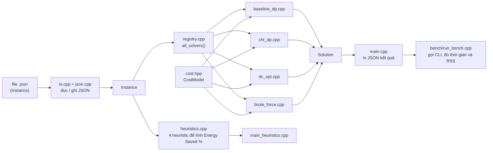

# Thiết kế module và API (việc 3.04)

Nguồn chuẩn về toán học: tài liệu "Phát biểu hình thức bài toán (1.05)" (xem [model.md](model.md)).
Nếu tài liệu này mâu thuẫn với code, **code là sự thật hiện tại**, hãy sửa tài liệu này.

## 1. Bức tranh chung



Nguyên tắc thiết kế:

1. **Một công thức chi phí duy nhất** (`cost.hpp`). Không solver nào tự viết lại công thức.
2. **Một chữ ký solver duy nhất** (`Solution solve_xxx(const Instance&)`), nên thêm solver mới chỉ cần
   một file `.cpp` và một dòng trong `registry.cpp`.
3. **Mỗi solver một file riêng** để giảm xung đột khi merge (rủi ro số 8 trong sheet).
4. **Solver không tự in và không tự đo giờ**; CLI lo phần đó. Nhờ vậy thời gian đo được là của riêng thuật toán.

## 2. Các module

| Module | File | Vai trò | Phụ trách |
|---|---|---|---|
| Kiểu dữ liệu | `include/edgedp/types.hpp` | `Params`, `Instance`, `Segment`, `Solution`, `NotImplemented` | TV3 |
| Hàm chi phí | `include/edgedp/cost.hpp` | `CostModel`: tổng tiền tố S, `work(k,i)`, `cost(k,i)`, `inf()` | TV3 |
| Giao diện solver | `include/edgedp/solver.hpp`, `src/registry.cpp` | Khai báo 4 solver, danh sách `all_solvers()` | TV3 |
| Baseline DP | `src/baseline_dp.cpp` | DP gốc O(M·N²), mốc đối chiếu của mọi solver | TV3 |
| CHT | `src/cht_dp.cpp` | Convex Hull Trick (chỉ cho biến thể bậc hai) | TV3 |
| D&C Optimization | `src/dc_opt.cpp` | O(M·N log N), dựa trên QI | TV4 |
| Vét cạn | `src/brute_force.cpp` | Chuẩn đúng cho N nhỏ (N ≤ 12) | TV4 |
| JSON | `src/json.hpp`, `src/json.cpp` | Bộ đọc JSON tối giản, không phụ thuộc thư viện ngoài | TV3 |
| I/O | `src/io.hpp`, `src/io.cpp` | `parse_instance_json`, `read_instance_json`, `solution_to_json` | TV3 |
| CLI | `src/main.cpp` | `edgedp --algo X --input F`, đo thời gian, in JSON | TV3 |
| Heuristic | `include/edgedp/heuristics.hpp`, `src/heuristics.cpp`, `src/main_heuristics.cpp` | Greedy, chia đều, 1 node, round-robin | TV5 |
| Benchmark | `bench/run_bench.cpp` | Chạy CLI nhiều lần, đo thời gian và RSS, xuất CSV | TV5 |
| Sinh dữ liệu | `scripts/gen_data.py` | Sinh instance JSON và `manifest.csv` | TV5 |
| Test | `tests/test_main.cpp` | Unit test, vét cạn làm oracle, đối chiếu chéo các solver | TV3, TV4 |

## 3. Kiểu dữ liệu (types.hpp)

```cpp
using ll = long long;     // w, d, S, chỉ số
using ld = long double;   // năng lượng (quyết định họp tuần 1)

struct Params   { ld kappa_over_T2, e_on, eps, cap, link_cap; };
struct Instance { int n, m; std::vector<ll> w, d; Params params; std::string source; ll seed; };
struct Segment  { int from, to; ll work; ld cost; };          // chỉ số tác vụ tính từ 1
struct Solution { bool feasible; ld energy; int nodes_used;
                  std::vector<int> cuts; std::vector<Segment> segments;
                  std::string solver; double time_ms; };      // 2 trường cuối do CLI điền
```

**Quy ước chỉ số (dễ nhầm nhất, đọc kỹ):**

| Trong tài liệu toán | Trong code |
|---|---|
| w₁..w_N | `w[0..n-1]`, tức `w[i-1]` là w_i |
| d₀..d_{N−1} | `d[0..n-1]`, tức `d[k]` là d_k |
| S₀..S_N | `S[0..n]` trong `CostModel` |
| Cost(k+1, i) | `cost(k, i)`, nhận **chỉ số tiền tố** k, đoạn gồm τ_{k+1}..τ_i |
| `cuts`, `Segment.from/to` | chỉ số tác vụ **tính từ 1** |

## 4. Hàm chi phí (cost.hpp)

```
Cost(k+1, i) = E_on + (κ/T²)·(S_i − S_k)³ + ε·d_k
Cost = +∞  nếu S_i − S_k > cap,  hoặc (k ≥ 1 và d_k > link_cap)
```

- `cost(k, i)` yêu cầu `0 <= k < i <= n`. Không kiểm tra biên (để giữ O(1) và nhanh).
- `d[0]` là dữ liệu từ thiết bị IoT lên node đầu, **không** chịu ràng buộc `link_cap`.
- Giá trị vô hạn dùng `inf()` (`long double` vô cực thật). Solver phải bỏ qua trạng thái `prev[k] == inf()`
  trước khi cộng, để không sinh `inf + inf` hay so sánh sai.

## 5. Hợp đồng của một solver

Mọi hàm `solve_xxx(const Instance&)` phải đảm bảo:

1. **Đúng giá trị tối ưu:** `energy` bằng energy của baseline với sai số tương đối ≤ 1e-9
   (test so `energy`, **không** so `cuts`, vì có thể có nhiều nghiệm tối ưu bằng nhau).
2. **Nghiệm hợp lệ khi `feasible = true`:**
   - `segments` phủ liền mạch τ_1..τ_N, không chồng, không hở; `nodes_used == segments.size() ≤ m`.
   - `cuts.size() == nodes_used − 1` và `cuts[t] == segments[t].to`.
   - mỗi đoạn có `cost` hữu hạn, `work == S[to] − S[from−1]`, `energy == tổng cost các đoạn`.
3. **Không khả thi không phải lỗi:** trả `feasible = false` (các trường còn lại không có nghĩa), **không ném ngoại lệ**.
4. **Trường hợp biên đã chốt:**

   | Tình huống | Kết quả |
   |---|---|
   | `n == 0` | `feasible = true`, `energy = 0`, `nodes_used = 0`, không đoạn nào |
   | `n > 0` và `m == 0` | `feasible = false` |
   | Có tác vụ nặng hơn `cap` | `feasible = false` |

5. **Quy tắc hòa (tie-break):** khi nhiều lựa chọn cho cùng giá trị, chọn **k nhỏ nhất**, rồi **j nhỏ nhất**
   (baseline làm đúng như vậy với phép so `<` chặt). D&C bắt buộc theo quy tắc này vì tính đơn điệu
   `opt(i,j) ≤ opt(i+1,j)` chỉ được đảm bảo khi chọn k nhỏ nhất.
6. **Chưa cài thì ném `NotImplemented`.** Test sẽ báo SKIP thay vì FAIL; CLI trả mã thoát 3.
7. **Thuần hàm:** không in ra màn hình, không dùng biến toàn cục có trạng thái, không đọc file. Không tự điền `solver` và `time_ms`.

## 6. Đăng ký solver (registry.cpp)

```cpp
const std::vector<SolverEntry>& all_solvers();   // {"baseline","cht","dc","bruteforce"}
```

CLI, `tests/test_main.cpp` và `bench/run_bench.cpp` đều duyệt danh sách này.
Test `cross_check_<tên>_vs_baseline` được **tự động tạo** cho mọi solver khác `baseline`.

**Thêm solver mới:** (1) viết `src/xxx.cpp` đúng chữ ký, (2) khai báo trong `solver.hpp`,
(3) thêm một dòng vào `registry.cpp`. Không cần sửa test hay CLI.

## 7. Định dạng vào/ra

Đầu vào (JSON), `w` và `d` mỗi mảng đúng `n` phần tử, không âm, số nguyên:

```json
{ "n": 5, "m": 3, "w": [2,3,1,4,2], "d": [3,4,2,6,1],
  "params": { "kappa_over_T2": 1.0, "e_on": 250.0, "eps": 1.0, "cap": 8.0, "link_cap": 5.0 },
  "seed": 7, "source": "synthetic" }
```

`seed` và `source` là tùy chọn (để tái tạo thí nghiệm). Thiếu trường bắt buộc, sai kiểu hoặc sai kích thước thì
`parse_instance_json` ném `std::runtime_error`.

Đầu ra (JSON): `feasible`, `energy` (**`null`** nếu không khả thi), `nodes_used`, `cuts`, `segments`, `solver`, `time_ms`.

## 8. Giao diện dòng lệnh

```
edgedp --algo <baseline|cht|dc|bruteforce> --input <file.json>
```

| Mã thoát | Ý nghĩa |
|---|---|
| 0 | Chạy xong (kể cả `feasible = false`), JSON in ra stdout |
| 2 | Tham số hoặc input sai |
| 3 | Solver chưa cài đặt |

`run_bench` dựa vào đúng hợp đồng này (đọc `solver`, `feasible`, `energy`, `time_ms` từ stdout và mã thoát 3),
nên **đổi tên trường JSON hay mã thoát là phá benchmark**; phải báo TV5 trước.

Công cụ phụ: `edgedp_heur --input F | --dir D [--dp-max-n N]` chạy 4 heuristic và tính
Energy Saved % so với DP baseline (chỉ khi `n ≤ dp-max-n` vì baseline là O(M·N²)).

## 9. Quy ước số học

- w, d, S, chỉ số: `long long`. Năng lượng: `long double`.
- Tràn số: với W lớn, `(κ/T²)·W³` có thể rất lớn; `long double` chịu được cỡ dữ liệu hiện tại nhưng
  **CHT bậc hai** có tích chéo khi so giao điểm, nên dùng `__int128` hoặc `long double` (rủi ro số 6).
- So sánh hai năng lượng: sai số tương đối ≤ 1e-9, không dùng `==` cho số thực ngoài trường hợp `inf()`.

## 10. Bộ nhớ và độ phức tạp

| Solver | Thời gian | Bộ nhớ |
|---|---|---|
| baseline | O(M·N²) | giá trị DP: 2 hàng, O(N); bảng `opt`: O(M·N) |
| D&C | O(M·N log N) | như trên |
| CHT (deque, bậc hai, không cửa sổ) | O(M·N) | như trên |
| CHT có cửa sổ `cap` | dùng Li Chao tree: O(M·N log² N) | như trên |

Bảng `opt` là `(m+1)·(n+1)` số nguyên 32 bit; với N = 10⁵, M = 32 khoảng 13 MB.

## 11. Chiến lược kiểm thử

| Lớp | Nội dung | Vị trí |
|---|---|---|
| Ví dụ trong tài liệu | N=5, M=3 phải ra 973, cắt sau τ2; E_on = 200 thì dùng 3 node (864) | `tests/data/example_n5.json`, `test_main.cpp` |
| Biên | n=0, m=0, tác vụ quá nặng, khối lượng 0, 1 tác vụ | `test_main.cpp` |
| Oracle độc lập | Vét cạn mọi tập điểm cắt (N ≤ 11) so với baseline trên 600 input ngẫu nhiên, có cả vô nghiệm | `test_main.cpp` |
| Đối chiếu chéo | `cross_check_*`: solver khác phải cùng `energy` và nghiệm hợp lệ trên 400 input ngẫu nhiên | `test_main.cpp` |
| I/O | Đọc/ghi JSON, từ chối input sai, `energy: null` khi vô nghiệm | `test_main.cpp` |

Kết quả có ba loại: PASS, FAIL, SKIP (chưa cài). CI (`.github/workflows/ci.yml`) chạy `make` và `make test` trên mỗi PR.

## 12. Việc còn mở (cần chốt, ghi rõ để không ai hiểu nhầm)

- [ ] **Tham số `model` (cubic/quadratic) trong `cost.hpp`:** biên bản họp 11/10 giao TV3, **chưa có trong code**.
  Hiện `cost()` chỉ có bậc ba. Dự kiến thêm `Params::model` và các hệ số `a`, `b` cho `a·W² + b·W`,
  mặc định `cubic` để mọi thứ cũ không đổi.
- [ ] **Cách CHT xử lý cửa sổ `cap`:** deque chuẩn sai khi có cửa sổ trượt; chọn Li Chao tree hoặc chỉ dùng CHT khi bỏ `cap`.
- [ ] **Quy tắc D&C với +∞:** khi mọi k trong khoảng cho +∞ thì `opt` tùy ý, có thể phá đơn điệu (TV4 và TV2 xác nhận).
